# Racing AI: cars that learn to drive with a genetic algorithm

Project for the course Artificial Intelligence

## 1. Idea

The project is a 2D top-down racing game. The cars are not driven by rules
that I wrote. Every car has a small neural network that looks at distance
sensors and decides how much to steer and whether to accelerate or brake.
The weights of the network are found with a genetic algorithm (lecture 6):
a population of random drivers is tested on the track, the best ones are
selected, crossed and mutated, and this is repeated for many generations.

The best car of every generation is saved. In the game these saved cars race
against each other, so the evolution can be seen directly: the car from
generation 0 crashes in the first corner, the cars from the middle
generations finish the lap slowly and the last generation drives it fast.
The player can also join the race with the keyboard.

Everything is written in Python with numpy (calculations), pygame (the game)
and matplotlib (the plots). The physics, the neural network and the genetic
algorithm are written from scratch, no machine learning library is used.

## 2. The environment

### 2.1 Track

A track is saved as a short list of control points. A closed Catmull-Rom
spline is drawn through the points and points on the curve are taken every
4 metres. This is the centre line. The left and the right wall are the
centre line moved 6 m to each side (the road is 12 m wide). Every point of
the centre line is also a checkpoint, they are used to measure how far a car
has driven.

There are 6 tracks drawn by hand and 12 random tracks. The random tracks are
circles whose radius is changed by a few sine waves. A track is only
accepted if the sharpest corner is not too sharp and the road does not
touch itself.

The tracks are split in two groups:

- training tracks: `oval`, `bean`, `esses`, `clip` and `random_7` to `random_12`.
  Each one is driven in both directions. The first trainings and the
  experiments only used `oval`, `bean` and `esses`, the others were added
  for the final training (section 8).
- test tracks that are never used in any training: `hairpins`, `circuit`, `random_1` to `random_6`

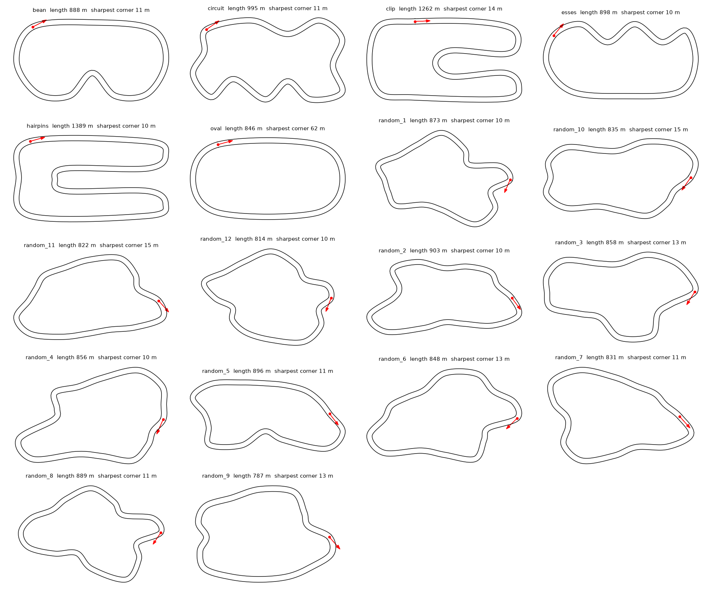

### 2.2 Physics of the car

The car is a point with a direction and a speed. In every step
(1/60 of a second) the forces along the car are added up:

    force = engine - brake - air drag - rolling resistance
    engine = throttle * 8500 N           brake = brake pedal * 15000 N
    air drag = 2.2 * v^2                 rolling resistance = 25 * v
    acceleration = force / mass          (mass = 1200 kg)
    v = v + acceleration * dt

The top speed is where the engine force is equal to the resistance, about
57 m/s (205 km/h). The car reaches 100 km/h in about 4.4 seconds.

Steering uses the bicycle model. If the front wheels are turned by the
angle `a`, the car drives on a circle and its direction changes with

    turn rate = v / wheelbase * tan(a)

The tyres have limited grip. The sideways acceleration `v * turn rate`
cannot be bigger than `grip * g` (1.25 * 9.81 m/s^2). If the car is too
fast for the corner the turn rate is cut to this limit and the car goes
wide. Because of this the cars have to brake before sharp corners, full
throttle all the time ends in the wall.

### 2.3 Sensors

A car does not know the track. It only has 7 distance sensors that look in
the directions -90, -45, -20, 0, 20, 45 and 90 degrees from the direction of
the car. Every sensor gives the distance to the first wall in its direction,
at most 100 m. The distance is calculated as the intersection of the ray
with the wall segments (ray casting).

### 2.4 Crash and progress

Four short rays go from the centre of the car to its four corners. If a
wall is closer than the corner, the car has hit the wall and it stops.
A car is also stopped if it does not pass a new checkpoint for 3 seconds
(it stands still or drives in the wrong direction).

The progress of a car is the number of checkpoints it has passed times 4 m,
plus the part of the way to the next checkpoint.

## 3. The driver: a neural network

Every car is controlled by a small feed-forward network (lecture 11):

- 8 inputs: the 7 sensor distances divided by 100 and the speed divided by the top speed
- 1 hidden layer with tanh activation. It had 8 neurons at the start and 16 in the final version (experiment 7.6)
- 2 outputs with tanh, so they are between -1 and 1:
  steering (-1 full left, 1 full right) and throttle (positive = accelerate, negative = brake)

With 8 hidden neurons the network has 8*8 + 8 + 8*2 + 2 = 90 weights and
biases, with 16 hidden neurons 8*16 + 16 + 16*2 + 2 = 178.

The network cannot be trained with backpropagation like in the auditory
exercises, because there are no examples of the correct steering for every
situation. The only thing that can be measured is how well a car drove after
the whole drive is over. A genetic algorithm only needs this one number.

## 4. The genetic algorithm

The terms are the same as in lecture 6.

- **Chromosome**: all the weights of one network written as one vector of real numbers (90 or 178 genes). One weight is one gene.
- **Population**: 60 chromosomes, at the start random numbers from a normal distribution.
- **Fitness**: every car drives on every training track for at most 40 seconds.
  The fitness is the distance driven along the track in metres, averaged over
  the tracks. A crash ends the drive. This one number rewards both things I
  want: a car that survives longer gets further, and a faster car also gets further.
  Progress is measured with the checkpoints and not with the driven distance,
  otherwise a car that drives in circles would get a high fitness.
- **Selection**: tournament selection. 3 random individuals are picked and the best of them becomes a parent.
- **Crossover**: one point crossover with probability 0.7. A random crossover point
  is chosen, the child gets the genes before the point from the first parent and the rest from the second.
- **Mutation**: every gene is changed with probability 0.1 by adding a random number from a normal
  distribution N(0, sigma). Sigma was 0.3 at the start and 1.0 in the final version (experiment 7.1).
- **Elitism**: the 3 best chromosomes are copied to the next generation unchanged, so the best solution cannot be lost.

One generation:

    evaluate the fitness of all 60 chromosomes (drive on all training tracks)
    save the best chromosome
    new population = the 3 best chromosomes
    until the new population has 60 chromosomes:
        select two parents with tournament selection
        with probability 0.7 child = crossover(parents), else child = copy of the first parent
        mutate the child
        add the child to the new population

All the cars start from the same place and the simulation has no randomness,
so the same chromosome always gets the same fitness.

## 5. Implementation

| file | what is in it |
|---|---|
| `config.py` | all the constants |
| `track.py` | the track: spline, walls, checkpoints, ray casting |
| `simulation.py` | physics, sensors, crash and progress check |
| `network.py` | the neural network |
| `ga.py` | selection, crossover, mutation, building the next generation |
| `train.py` | the fitness function and the training loop |
| `experiments.py`, `plots.py` | the experiments and the pictures in this report |
| `game.py`, `draw.py`, `cars.py` | the game, the drawing and the car models |
| `parking.py`, `parking_levels.py` | the parking mini game and its 10 levels |

The slow part is the simulation. One generation is 60 cars on 6 drives of up
to 2400 steps. To make this fast enough all the cars are simulated together:
the position, speed and direction are numpy arrays with one value per car,
and the networks of all the cars are calculated with one matrix operation.
Ray casting was the bottleneck, three things made it faster:

- a car only checks the walls near its own checkpoint and not all the walls of the track,
- the sensors are read 30 times per second and not 60,
- the wall coordinates are stored as 32 bit numbers.

After this a training of 150 generations on 3 tracks takes about 8 minutes
on a laptop. `train.py` can also drive the different tracks on different
processor cores at the same time.

The game uses exactly the same `Simulation` class as the training, so a
trained car drives in the game the same way it drove in the training.

## 6. First training

The first training used the settings from section 4 (8 hidden neurons,
sigma 0.3), the tracks `oval`, `bean` and `esses` in both directions and 150
generations. It is saved in `runs/first`.

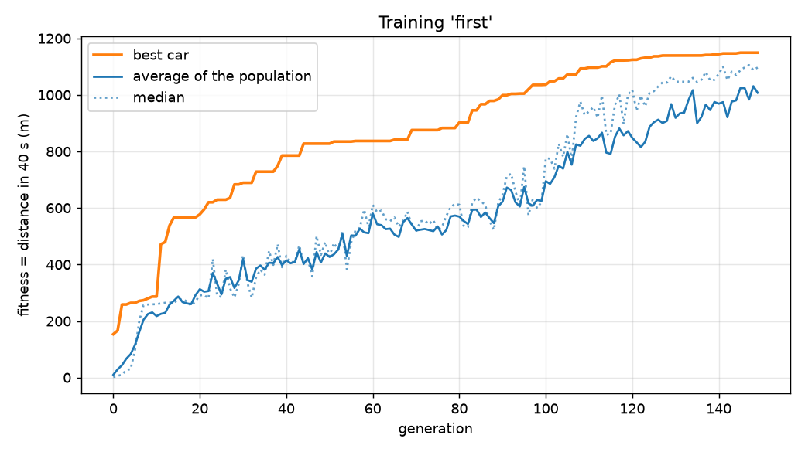

The best random car of generation 0 drives 154 m on average before it
crashes. After 150 generations the best car drives 1149 m in 40 seconds,
which is more than one full lap on every training track. The curve of the
best car goes up in steps: for some generations nothing happens and then a
mutation or a crossover finds something better. The average of the
population follows the best car with a delay, because the good genes spread
through the population by selection.

The next picture shows the best car of six generations on the track
`circuit`, which was never used for training. The colour is the speed.

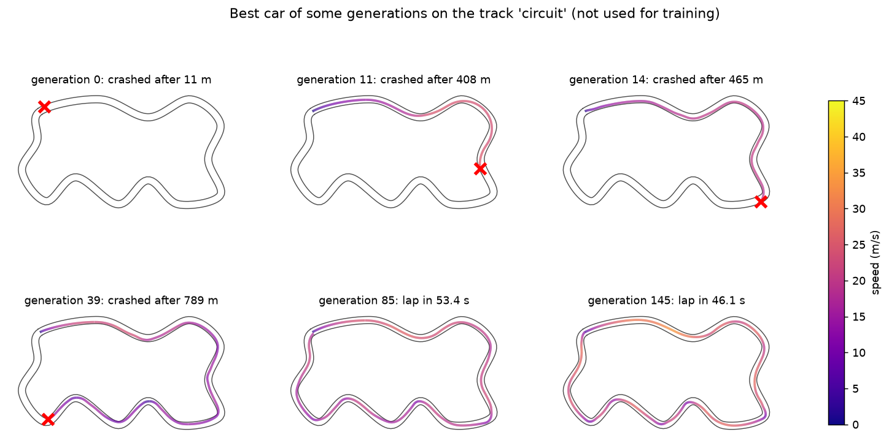

The car from generation 0 crashes after 11 m. The later cars get further
every time (408 m, 465 m, 789 m) and from generation 85 the car finishes the
lap. Generation 145 finishes it 7 seconds faster than generation 85
(46.1 s against 53.4 s). The cars also learned to slow down in the corners
(dark colour) and to accelerate on the straight parts.

To see how well the cars drive on tracks they do not know, the best car of
every 10th generation drove one lap on every track:

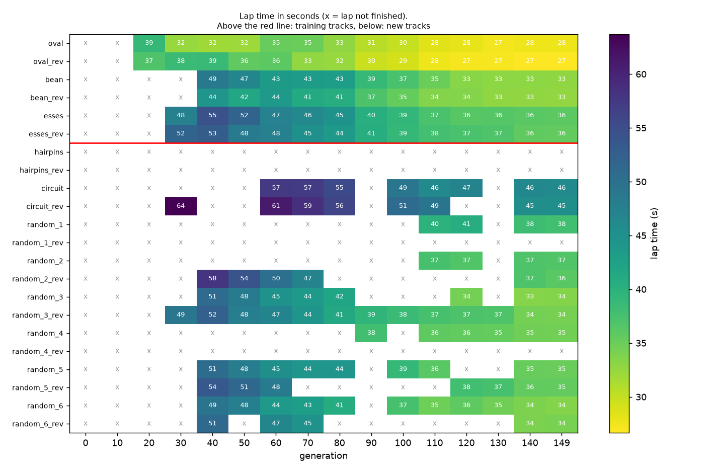

On the training tracks (above the red line) the lap times get better all the
time. On the new tracks the picture is less stable. The last generation
finishes 12 of the 16 new drives, but some earlier generations finish a
track that a later generation does not finish. The fitness only measures the
three training tracks, so a car can become better on them and at the same
time worse on some other track. No generation finishes `hairpins`: this
track has 180 degree turns and the training tracks have nothing like them.

## 7. Experiments

Every experiment changes one thing in the baseline settings and compares
the results. The baseline is the setting of the first training: population
60, tournament selection with 3 individuals, one point crossover with
probability 0.7, mutation rate 0.1, sigma 0.3, 3 elites, 8 hidden neurons,
3 tracks in both directions.

Every training runs for 60 generations (3600 evaluated cars) and is repeated
with 5 different random seeds, because one run of a genetic algorithm
depends a lot on luck. In total this is 115 trainings. Two numbers are
reported, as mean ± standard deviation over the 5 seeds:

- the best fitness on the training tracks,
- how many of the 16 test drives (8 new tracks, both directions) the best car finishes.

In the pictures the left plot is the best fitness so far, the line is the
mean of the 5 seeds and the coloured area is ± one standard deviation.

Five seeds are not many, so small differences between two settings do not
mean anything. I only draw a conclusion where the difference is clearly
bigger than the spread.

### 7.1 Size of a mutation

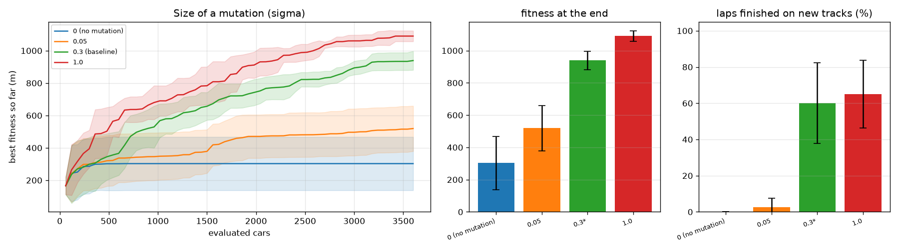

| sigma | best fitness (m) | new tracks finished |
|---|---|---|
| 0 (no mutation) | 303 ± 165 | 0 % |
| 0.05 | 519 ± 140 | 2 % |
| 0.3 (baseline) | 939 ± 58 | 60 % |
| 1.0 | 1090 ± 33 | 65 % |

Without mutation the fitness stops growing after a few generations.
Crossover can only mix the genes that are already in the population, and
when all the chromosomes have become similar nothing new can appear. Very
small mutations (0.05) are too slow. In the tested range bigger mutations
were better, sigma 1.0 was clearly better than my first choice 0.3.
The final training uses 1.0.

### 7.2 Mutation rate

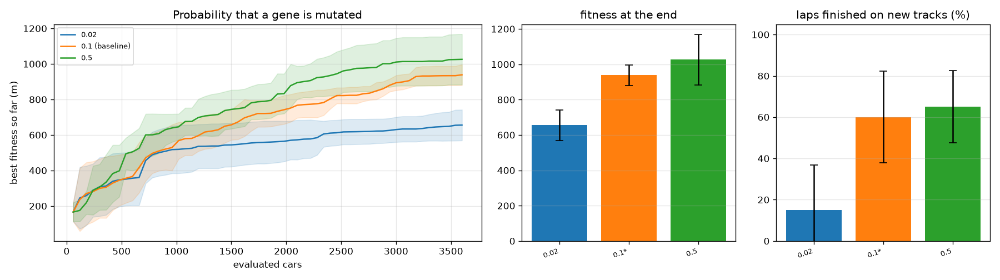

| probability per gene | best fitness (m) | new tracks finished |
|---|---|---|
| 0.02 | 656 ± 87 | 15 % |
| 0.1 (baseline) | 939 ± 58 | 60 % |
| 0.5 | 1026 ± 142 | 65 % |

A rate of 0.02 (about 2 changed genes per child) is too low. 0.5 has a
higher mean than 0.1 but also a much bigger spread, so I cannot say that it
is better. I kept 0.1.

### 7.3 Crossover

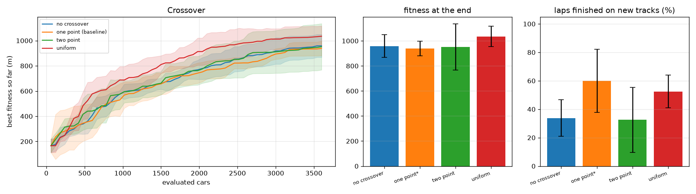

| crossover | best fitness (m) | new tracks finished |
|---|---|---|
| no crossover | 959 ± 91 | 34 % |
| one point (baseline) | 939 ± 58 | 60 % |
| two point | 952 ± 184 | 32 % |
| uniform | 1035 ± 82 | 52 % |

This was a surprise: without crossover the fitness is the same as with it.
The differences between the four variants are smaller than the spread.
I think the reason is the representation. In the 8 queens example from the
lecture a part of a chromosome is a part of a board, and it still makes
sense in another board. Here a part of a chromosome is a set of weights that
only works together with the other weights of the same network. Two good
networks can solve the problem in different ways, and a child with half of
each is often worse than both parents. In this problem the mutation does
most of the work. I kept one point crossover.

### 7.4 Selection and elitism

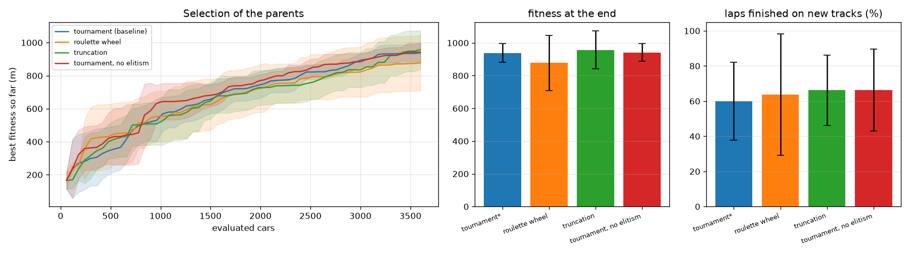

| selection | best fitness (m) | new tracks finished |
|---|---|---|
| tournament (baseline) | 939 ± 58 | 60 % |
| roulette wheel | 877 ± 169 | 64 % |
| truncation (random parent from the better half) | 957 ± 116 | 66 % |
| tournament without elitism | 942 ± 55 | 66 % |

All the variants reach about the same fitness. Roulette wheel selection has
the lowest mean and the biggest spread, but the difference is inside the
spread. The plot shows the best fitness found so far, so it does not show
that without elitism the best car of a generation can be lost again.
I kept tournament selection with elitism.

### 7.5 Population size

All three variants evaluate the same number of cars (3600).

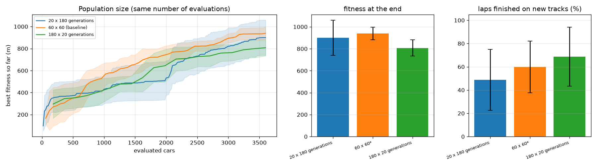

| population x generations | best fitness (m) | new tracks finished |
|---|---|---|
| 20 x 180 | 899 ± 160 | 49 % |
| 60 x 60 (baseline) | 939 ± 58 | 60 % |
| 180 x 20 | 808 ± 75 | 69 % |

The big population is the worst in fitness because 20 generations are not
enough. The small population gets a similar mean as the baseline but depends
much more on luck (spread 160 against 58). I kept 60.

### 7.6 Size of the hidden layer

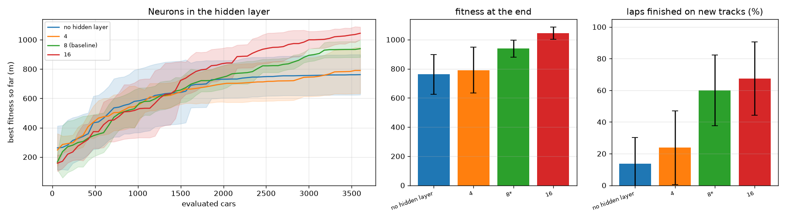

| hidden neurons | best fitness (m) | new tracks finished |
|---|---|---|
| no hidden layer | 762 ± 137 | 14 % |
| 4 | 790 ± 157 | 24 % |
| 8 (baseline) | 939 ± 58 | 60 % |
| 16 | 1044 ± 43 | 68 % |

Without a hidden layer the network is two perceptrons (lecture 10): the
steering and the throttle are a weighted sum of the sensors. Even this car
learns to drive a part of the track, but it finishes only a few new tracks.
More hidden neurons were better, although the chromosome becomes longer
(178 genes with 16 neurons) and the search space bigger. The final training
uses 16.

### 7.7 Genetic algorithm against simpler searches

Lecture 6 presents the genetic algorithm together with other local search
methods, so I compared it with two of them. All three evaluate 60 cars per
round for 60 rounds.

- Random search: every round 60 completely new random chromosomes, the best one ever is remembered.
- Hill climbing: start from the best of 60 random chromosomes. Every round make 60 neighbours
  (mutated copies of the current chromosome) and move to the best one if it is better than the current one.

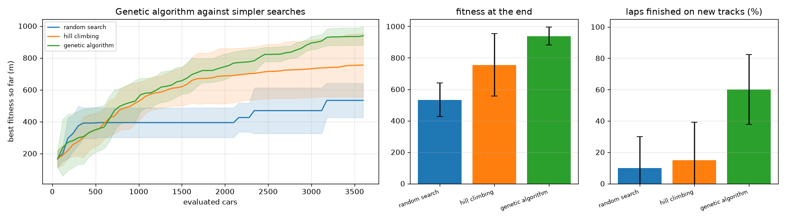

| algorithm | best fitness (m) | new tracks finished |
|---|---|---|
| random search | 533 ± 108 | 10 % |
| hill climbing | 755 ± 199 | 15 % |
| genetic algorithm | 939 ± 58 | 60 % |

Random search finds a car that drives a few corners and then almost stops
improving. Hill climbing is as good as the genetic algorithm in the first
rounds but then slows down, and its result depends a lot on the starting
point (spread 199): some runs get stuck early in a local maximum. The
genetic algorithm keeps many different solutions at the same time, so it is
both better and more reliable.

### 7.8 Training tracks

Here the fitness values cannot be compared, because they are measured on
different tracks. The interesting number is the result on the new tracks.

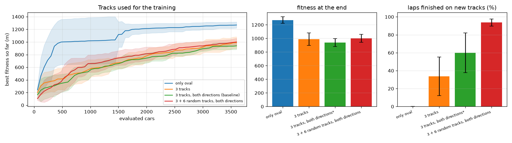

| training tracks | best fitness (m) | new tracks finished |
|---|---|---|
| only oval | 1269 ± 48 | 0 % |
| 3 tracks, one direction | 990 ± 92 | 34 % |
| 3 tracks, both directions (baseline) | 939 ± 58 | 60 % |
| 3 + 6 random tracks, both directions | 1000 ± 58 | 94 % ± 4 |

This is the clearest result of all the experiments. The cars trained only
on the oval are the fastest on the oval and do not finish a single new
track. They did not learn to drive, they learned the oval (overfitting).
Driving the same tracks also in the other direction almost doubles the
result on new tracks, because the cars see left and right corners equally
often. With 9 tracks the best car finishes 94 % of the new drives. More
different training data helped more than any setting of the genetic algorithm.

### 7.9 Fitness function

I tried to make the cars safer by taking 200 m away from the fitness when a
car crashes.

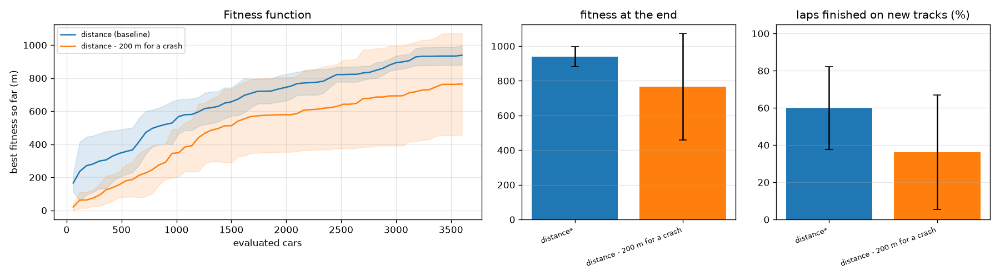

| fitness | new tracks finished | lap time on new tracks |
|---|---|---|
| distance (baseline) | 60 % ± 22 | 42.9 s |
| distance - 200 m for a crash | 36 % ± 31 | 47.4 s |

The penalty did not help. The cars were slower on the laps they finished
and they did not finish more new tracks, the mean is even lower (but with a
big spread). A possible reason is that in the first generations almost
every car crashes, so the penalty makes all the fitness values smaller by
the same amount and does not help the selection. I kept the simple fitness.

## 8. Final training

The final training uses what the experiments showed:

- sigma 1.0 for the mutation (7.1),
- 16 hidden neurons, so 178 genes (7.6),
- more training tracks (7.8): `oval`, `bean`, `esses`, the new track `clip`
  with two 180 degree turns and the random tracks 7 to 12, all in both
  directions. One generation is 60 cars on 20 drives.

Everything else stayed as in the baseline. The training ran for 300
generations and was repeated with 3 seeds. All three ended almost at the
same fitness (1118 m, 1109 m and 1117 m). The run with the highest fitness
is saved as `runs/main` and is used in the game.

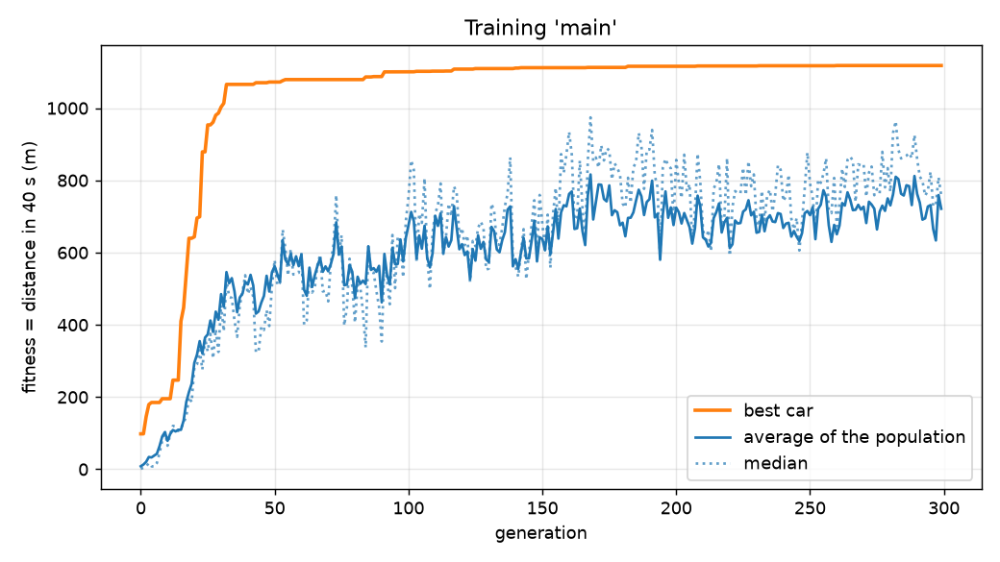

With the new settings the training is much faster at the start: the best
car passes 1000 m in generation 30, the first training needed about 90
generations for that. After generation 50 the curve is almost flat.

The last generation finishes a lap on all 20 training drives. Lap times of
the first and the final training on some tracks:

| track | first training | final training |
|---|---|---|
| oval (training) | 27.5 s | 26.8 s |
| bean (training) | 32.8 s | 31.6 s |
| esses (training) | 35.9 s | 33.5 s |
| circuit (new) | 46.1 s | 42.5 s |
| random_2 (new) | 36.7 s | 34.3 s |
| random_5 (new) | 35.1 s | 33.7 s |

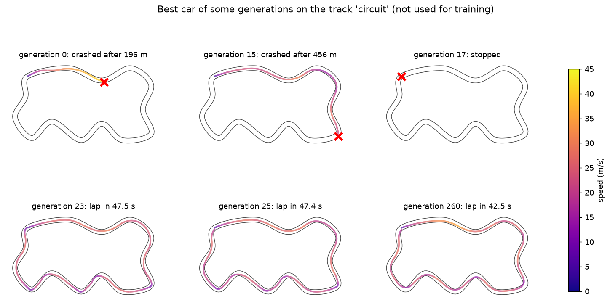

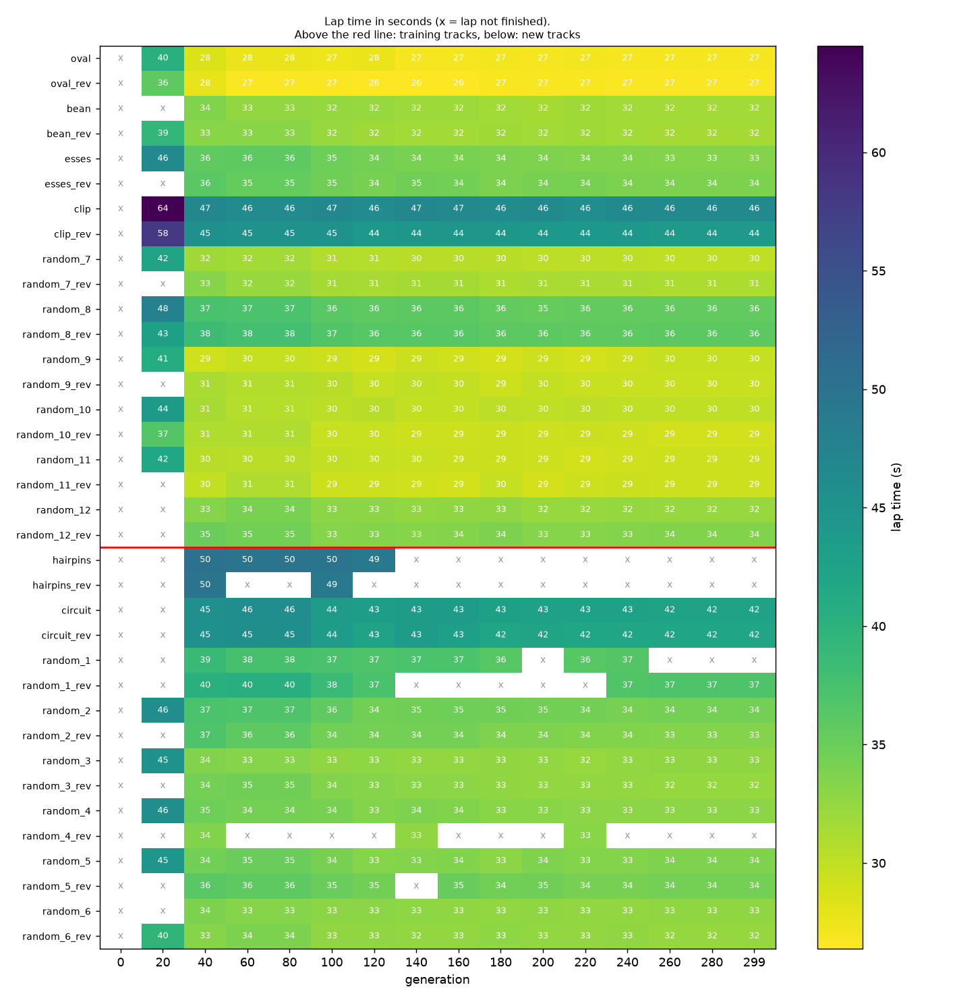

### Overfitting

On the new tracks the last generation finishes 12 of 16 drives. That is not
better than the first training, and worse than the 94 % of the experiment
in 7.8, which ran for only 60 generations. To understand this I tested the
best car of every 10th generation on the new tracks, for all three seeds:

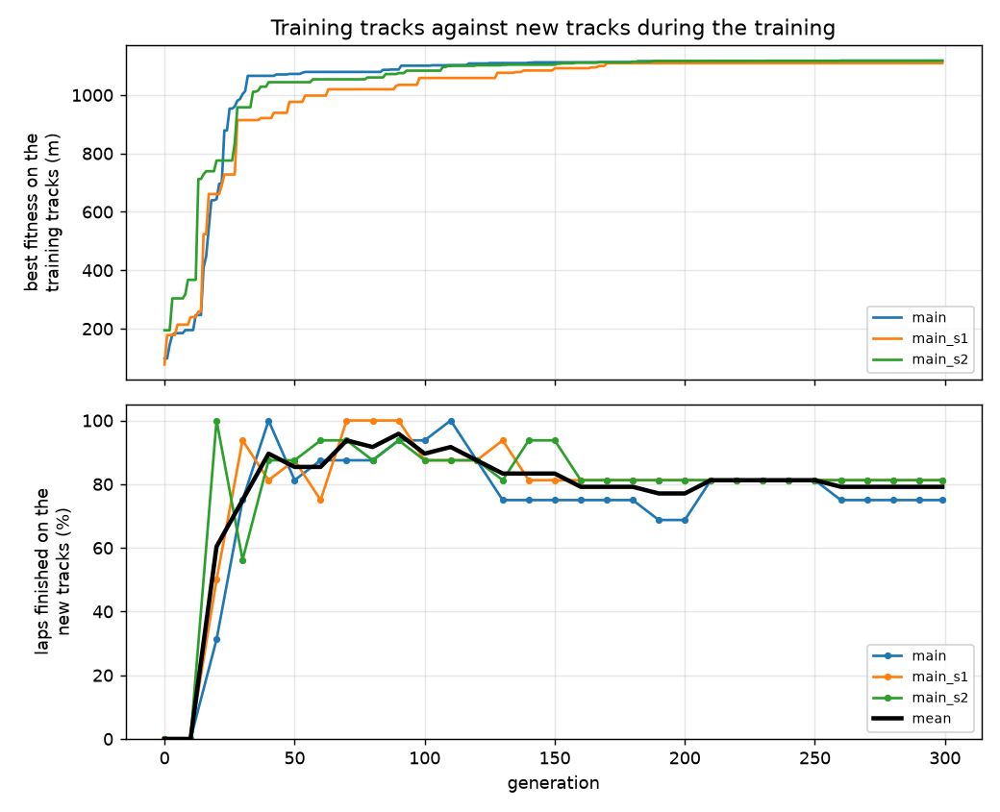

The upper plot is the fitness on the training tracks, it never goes down.
The lower plot is the result on the new tracks. It reaches about 90 %
between generations 70 and 110 (every seed has a generation that finishes
all 16 drives) and then it goes down to about 80 % and stays there.

This is overfitting, the same thing as a growing test error in machine
learning. From generation 100 to 299 the fitness on the training tracks
still grows a little (1101 m to 1118 m). The cars get this by driving
closer to the limit on exactly these tracks, and that makes them worse
somewhere else.

I looked at where the last car fails:

- `hairpins` in both directions: the track has a 260 m straight that ends in
  a 180 degree turn. In the training no long straight ends in such a sharp
  corner. The car reaches 46 to 48 m/s there, brakes too late and hits the
  wall of the turn at 26 to 29 m/s. The cars of generation 40 and 100 are
  more careful and finish the lap (in about 50 s).
- `random_4` reversed: a crash in a corner after 300 m.
- `random_1`: the car does not start at all. At the start there is a wall
  13 m in front of it, the network brakes and the car stands still.

Two things would fix this and are the next step for the project: keep some
tracks as a validation set and take the generation with the best validation
result instead of the last one (early stopping), and add training tracks
with long straights.

## 9. The game

The game is started with `python game.py`. In the menu the mode, the track,
the car of the player, the training whose cars are used and the number of
laps are chosen. There are six modes.

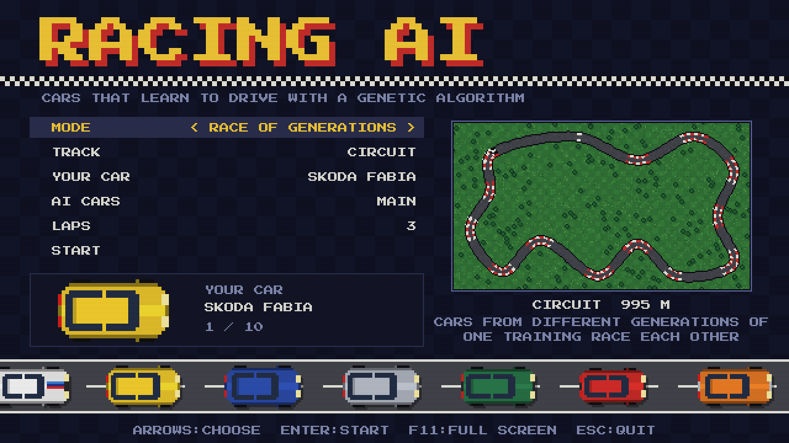

The game has a retro look. Everything is drawn without smoothing on a small
picture of 640 x 360 pixels and this picture is shown two times bigger in
the window, which gives the big pixels of old games. The text uses a pixel
font and thin dark lines over the picture imitate an old monitor (F10 turns
them off).

There are 10 car models that were common on our roads: Skoda Fabia, Opel
Astra, VW Golf 4, VW Golf 2, Yugo 45, Zastava 101, Zastava 750, Lada 2107,
Mercedes W124 and BMW E30. Every model is a small pixel picture that is
built in the code from a few numbers (length, width, length of the hood and
the trunk, colour) and turned in 64 directions. The models only look
different. All the cars use the same physics, because the neural networks
were trained with that physics and would not drive well with another one.

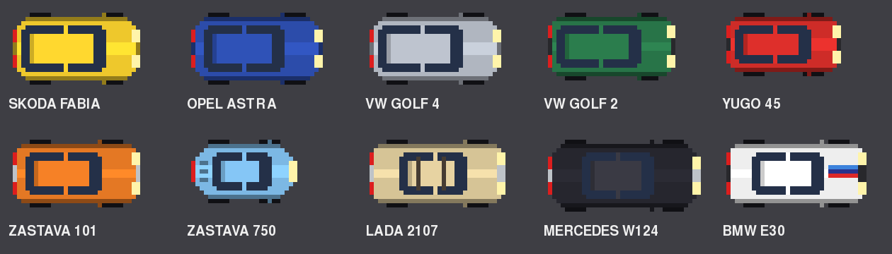

**Race of the generations.** The game takes one saved training and chooses
about seven generations from it: generation 0 and the first generations that
reached 1/6, 2/6, ... of the way from the first to the final fitness. Their best cars race
each other for the chosen number of laps. A car that crashes is put back on
the road at its last checkpoint after 1.5 seconds, so the weak generations
stay in the race and fall behind. The panel on the right shows the
positions, and for one car its speed, its controls and its neural network
with the current values of the neurons.

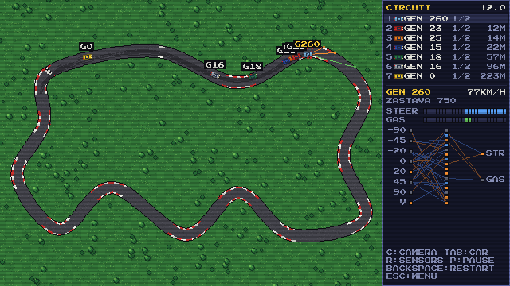

The camera can show the whole track or follow one car. The coloured lines
are the sensors of the car.

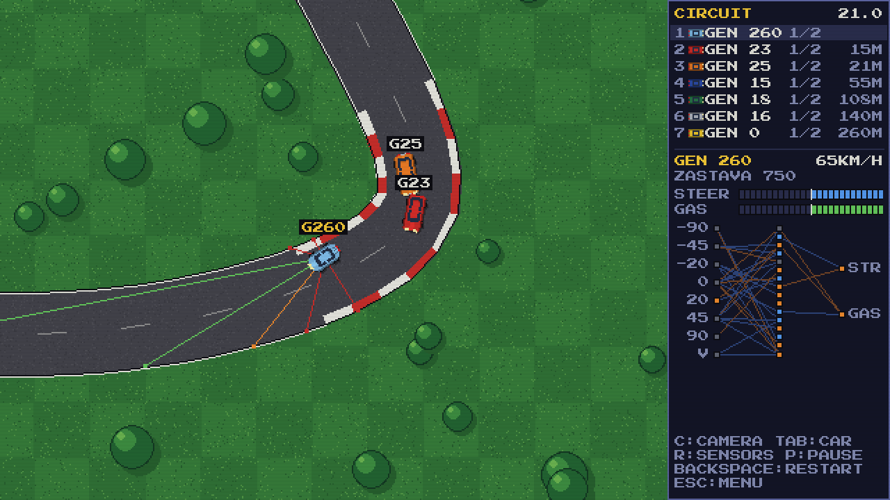

At the end the result table shows the time, the best lap and the number of
crashes of every car.

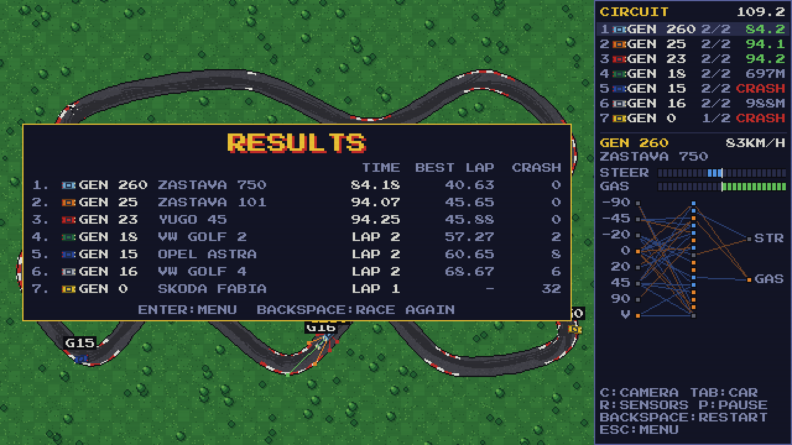

**Race against the AI.** The same race with one more car that is driven
with the keyboard. The player chooses the model in the menu, the AI cars
get the other models.

**Watch the training.** A new training is started on the chosen track and
all 60 cars of a generation are shown at the same time. The cars with a
yellow arrow are the elites from the last generation, the white arrow shows
the leader. A crashed car leaves a small cross. The plot shows the best and the average
fitness of every generation. The training can be made up to 32 times faster.
The best car of every generation is saved, so afterwards the generations of
this training can race each other too.

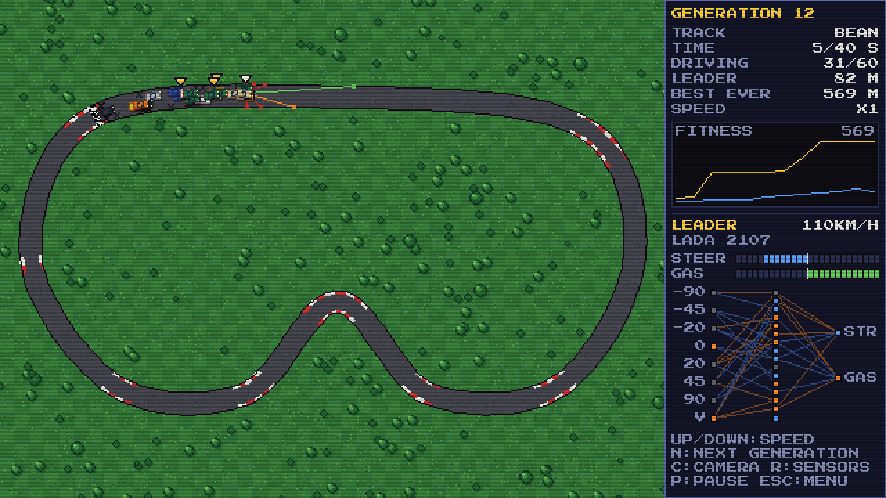

**Free drive.** Driving alone with lap times.

**Track editor.** A new track is drawn with the mouse by clicking the
control points. The editor checks that the corners are not too sharp. The
saved track can be used in all the other modes. This is the best test of the
trained cars, because the track did not exist when they were trained.

**Parking.** A mini game without artificial intelligence: the player has to
park the car in the marked bay of a parking lot. There are 10 levels that
get harder: a free bay, a bay between two cars, reverse parking with the
nose in a given direction, parallel parking, a lot with islands and cones,
and at the end other cars that drive through the lot. Parking needs two
things that the racing simulation does not have, so this mode has its own
small physics:

- a reverse gear, and the car turns around its rear axle like a real car,
- collisions between cars. Every car is a rectangle and two rectangles are
  tested with the separating axis test: they do not touch if they can be
  separated along the direction of one of their sides.

Here the size of the car model matters, a Zastava 750 (3.6 m) is much easier
to park than a Mercedes (5.1 m). When the car touches anything the game
shows CRASH! and puts it back to the start of the level.

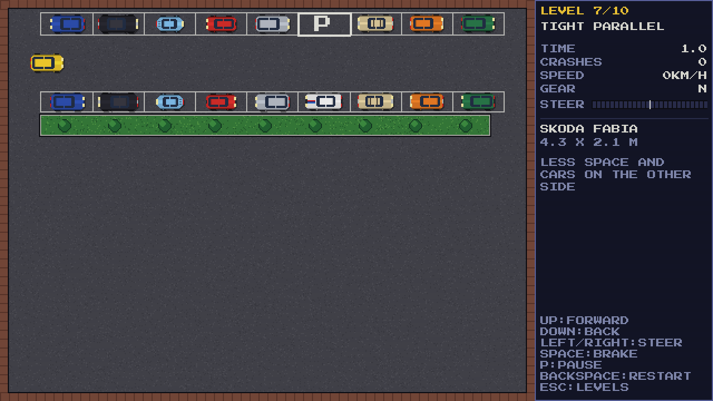

## 10. Limits and possible improvements

- The cars do not collide with each other. In a race they drive through
  each other, each car drives as if it was alone on the track.
- The physics is simple. There is no drifting and no weight transfer, the
  grip limit only makes the car turn less.
- The network has no memory. It reacts only to what the sensors show at this moment.
- The cars only see walls up to 100 m and only in 7 directions.
- The experiments changed one setting at a time and ran for 60 generations.
  The best settings were then used together in the final training without
  testing every combination, and results after 300 generations could be different.
- The final cars are overfitted to the training tracks (section 8). The last
  generation is the fastest but not the safest on new tracks.
- A genetic algorithm needs many evaluations. The final training simulated
  18000 cars on 20 drives each. Reinforcement learning (lecture 13) uses the
  reward of every single step and would be the next thing to try and compare.

## 11. How to run

    python -m venv .venv
    source .venv/bin/activate        (Windows: .venv\Scripts\activate)
    pip install -r requirements.txt

    python game.py                   the game
    python train.py                  the final training again (saves to runs/main)
    python experiments.py            all the experiments
    python plots.py main             the pictures of one training

## 12. Sources

- Course lectures: 6 (Local Search and Genetic Algorithms), 10 (Perceptrons), 11 (Neural Networks).
- S. Russell, P. Norvig: Artificial Intelligence: A Modern Approach, chapter 4 (local search and evolutionary algorithms).
- E. Catmull, R. Rom: A class of local interpolating splines, 1974 (the spline used for the tracks).
- Documentation of numpy (numpy.org), pygame-ce (pyga.me) and matplotlib (matplotlib.org).
- The font in the game is Press Start 2P by CodeMan38 (SIL Open Font License).
